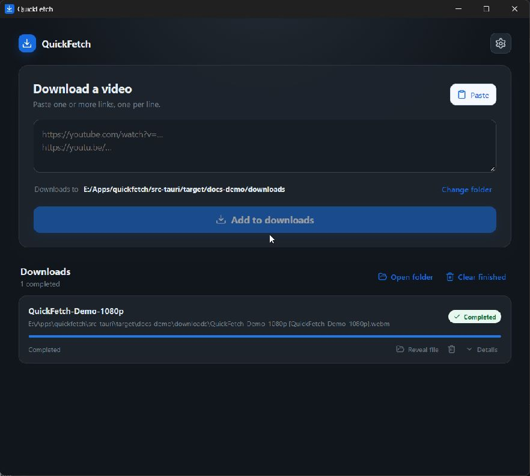
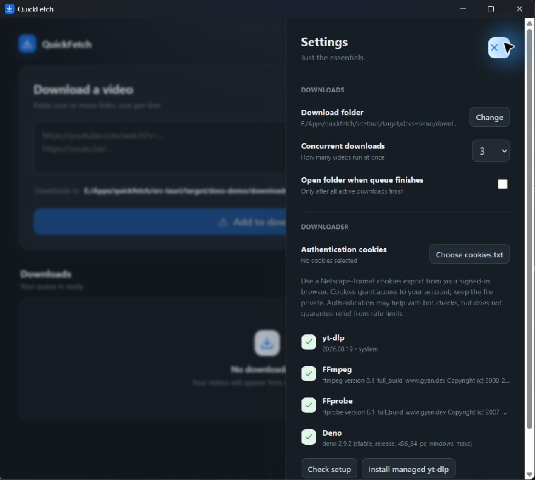

# QuickFetch — Lightweight Video Downloader for Windows

Download videos with a clean desktop queue, live progress, and the power of **yt-dlp**. QuickFetch is an open-source Windows app built with Tauri, React, and Rust.

[](https://github.com/airesearch-official/quickfetch/releases/latest)
[](https://github.com/airesearch-official/quickfetch/actions/workflows/windows.yml)
[](LICENSE)

**[Download for Windows](https://github.com/airesearch-official/quickfetch/releases/latest)** · **[Getting started](#getting-started)** · **[Report a problem](https://github.com/airesearch-official/quickfetch/issues)**



The screenshots show v0.1.1 with generated demo media and sample settings. Check the release notes for the features included in your download.

## Why QuickFetch?

- **A small desktop app.** The published v0.1.0 Windows installer is approximately 1.9 MB. WebView2 and downloader tools are separate dependencies.
- **Multiple links, one queue.** Paste one URL per line. Run up to five downloads at once, with three enabled by default.
- **Visible progress.** Follow percentage, downloaded size, total size, speed, and remaining time. Cancel or retry individual jobs.
- **Video with audio.** Prefer WebM streams up to 1080p. If merging fails, QuickFetch tries a lossless stream-copy recovery into MKV.
- **Recovery after a restart.** Unfinished jobs return as **Ready to resume**. Resume explicitly, with the original destination retained for started jobs.
- **Local settings.** Choose your download folder and concurrency. Optional `cookies.txt` authentication helps with sites that require sign-in.

## Getting started

### 1. Get the app

Open [GitHub Releases](https://github.com/airesearch-official/quickfetch/releases/latest) and choose a package.

| Download | Use it when |
| --- | --- |
| `QuickFetch_<version>_x64-setup.exe` | You want the Windows installer. Recommended for most users. |
| `QuickFetch_<version>_windows-x64-portable.zip` | You want to extract the app and run the executable directly. |
| `SHA256SUMS.txt` | You want to verify that your download matches the published package. |

QuickFetch targets **Windows 10/11 x64** and uses the **Microsoft Edge WebView2 Runtime**. Portable packages still store preferences in your Windows user profile. The current release is unsigned, so Windows may display an unknown-publisher warning.

### 2. Check your download tools

QuickFetch uses these external tools. Their downloads are separate from the small app installer.

| Tool | Purpose | Setup |
| --- | --- | --- |
| [yt-dlp](https://github.com/yt-dlp/yt-dlp) | Retrieves video information and downloads media | Install from QuickFetch Settings, or provide it on PATH. |
| [FFmpeg and FFprobe](https://ffmpeg.org/download.html) | Merge streams and check the resulting media | Install both executables together and add their folder to PATH. |
| [Deno](https://docs.deno.com/runtime/getting_started/installation/) | Runs yt-dlp's YouTube JavaScript challenges | Install Deno 2.3 or newer and add it to PATH for full YouTube support. |

Open **Settings → Check setup** after installing tools. Restart QuickFetch if you changed PATH while it was open. The source build checks Deno explicitly and provides links for missing dependencies.



### 3. Download

1. Paste one or more supported video links, one per line.
2. Check the destination shown below the input box.
3. Click **Add to downloads**, or press **Ctrl+Enter**.
4. Follow the queue. Use **Reveal file** on a completed job to select its output in File Explorer.

Use QuickFetch for media you own or have permission to download. Site availability and authentication requirements can change.

## Privacy and verification

- QuickFetch's source contains no analytics or advertising integration. Downloads contact the media sites you select. Tool setup contacts GitHub, and setup-help buttons open official documentation in your browser.
- Settings and queue history stay in the per-user application config directory. Queue history includes the URLs you entered, titles, and output paths. Clear finished entries or remove a job to remove it from saved history.
- A selected cookie file stays on disk. QuickFetch stores its path and passes it to yt-dlp. Cookie files can grant account access, so keep them private and out of issue attachments.
- Managed yt-dlp setup on `main` downloads the executable and SHA-256 manifest from the same official release tag, verifies the checksum, and replaces the binary only after verification. It uses a separate managed copy.
- Public app releases include package checksums. The source, test coverage, and limitations are available in the [audit report](docs/AUDIT.md).

To check an installer in PowerShell, run the following command and compare its hash with the corresponding entry in `SHA256SUMS.txt` from the same release.

```powershell
Get-FileHash .\QuickFetch_0.1.0_x64-setup.exe -Algorithm SHA256
```

Checksums detect changed bytes. The app packages currently have no code-signing certificate or independent security certification.

## Troubleshooting

| What you see | What to try |
| --- | --- |
| FFmpeg or FFprobe missing | Install both tools, add the containing folder to PATH, restart QuickFetch, and use Check setup. |
| YouTube asks you to sign in or confirm you are human | Complete the check in your browser. If needed, select a Netscape-format `cookies.txt` export in Settings and retry. Check Deno setup too. |
| HTTP 429 / Too Many Requests | Wait before retrying and reduce concurrent downloads. Authentication may help, but rate limits can persist. |
| Percentage goes back down | yt-dlp downloads video and audio as separate streams. The displayed percentage and byte totals describe the current stream. `~` marks an estimated total. |
| Output is MKV instead of WebM | Merge recovery preserved the downloaded codecs in an MKV container. Use the completed job's Reveal file action. |
| A job returns as Ready to resume | QuickFetch closed before the job finished. Click Resume. yt-dlp can reuse compatible partial files that are still available. |
| Details is empty after restarting | Diagnostic text is kept in memory for the current session. Queue metadata survives a restart. |

Recovery preserves source streams and can leave partial files beside the output. Validation checks for video, audio, and positive duration with FFprobe. It does not decode every frame. DRM-protected media is outside the app's supported workflow.

## Build from source

Install Node.js 22.16 or newer, npm, stable Rust with `rustfmt`, and the [Tauri Windows prerequisites](https://v2.tauri.app/start/prerequisites/), including Visual Studio C++ Build Tools and WebView2.

```powershell
git clone https://github.com/airesearch-official/quickfetch.git
cd quickfetch
npm ci
npm run tauri -- dev
```

Run the checks before contributing.

```powershell
npm run typecheck
npm run lint
npm test
cargo fmt --manifest-path src-tauri/Cargo.toml --check
cargo test --locked --manifest-path src-tauri/Cargo.toml
```

The opt-in integration suite uses real processes and generated local media. It requires yt-dlp, FFmpeg, FFprobe, Python, and rustc on PATH. One test also downloads and verifies the current upstream yt-dlp release from GitHub.

```powershell
cargo test --locked --manifest-path src-tauri/Cargo.toml --lib -- --ignored --test-threads=1
```

Build the Windows installer.

```powershell
.\node_modules\.bin\tauri.cmd build --bundles nsis
```

Find the installer in `src-tauri/target/release/bundle/nsis/`. The Windows workflow runs frontend and Rust checks, builds an installer, and performs an install-and-launch smoke test. See [Actions](https://github.com/airesearch-official/quickfetch/actions) for actual run results.

## Contributing and support

Bug reports and focused pull requests are welcome. For a download problem, include the QuickFetch version, Windows version, tool versions, expected behavior, and relevant Details output. Remove cookies, tokens, personal paths, and signed URLs before sharing logs.

[Open an issue](https://github.com/airesearch-official/quickfetch/issues) · [Read the changelog](CHANGELOG.md) · [Review the audit](docs/AUDIT.md)

QuickFetch is licensed under the [MIT License](LICENSE). yt-dlp, FFmpeg, Deno, WebView2, and other dependencies have their own licenses and terms.
